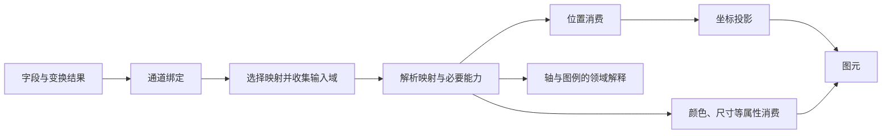

# Plot 比例尺设计

> 状态：重构目标设计，职责与公开边界见已接受的 ADR；不表示现有实现已支持文中全部组合
>
> 本文拥有比例尺的长期结构与职责边界。公开字段、默认值、失败行为和替代关系由后续 ADR 决定；现有代码、用户文档与 Accepted ADR 在替代决策生效前仍是当前契约依据。

关联：[Plot 总设计](./plot-design.md) · [可视化完备设计](./plot-visualization-complete.md) · [包职能设计](../../../../notes/architecture/package-responsibility-design.md)

具体决策见 [ADR-029](../decisions/plot/v0/v0.2/029-scale-mapping-contract.md)，当前为 Accepted；实现与验证进度独立记录。

## 1. 问题与目标

现有比例尺按 position 与 channel 两族提供公开扩展契约，后者实际主要输出颜色。位置结果携带坐标、带宽和刻度，颜色结果携带颜色 evaluator 与图例形态。大小、透明度和形状通过通道解析复用部分映射，但显式比例尺引用与 authoring 入口的能力并不一致。

这些差异把映射规则和使用场景过早绑定。例如，同一 threshold 分档规则可以用于颜色或点尺寸；同一 ordinal 类别映射可以输出颜色或形状标识。消费属性不同，不应要求重建分档或分类算法。

目标是按映射语义定义比例尺，由通道依据输入、输出及附加能力选择和消费。位置、颜色、大小等仍是必要的通道语义，但不再作为比例尺顶层互斥家族。

保留现有的统一 registry、成熟算法复用和图元 / Guide 同源解析。重构不以增加类型数量为目标，也不要求所有比例尺应用到所有属性。

## 2. 基本模型

比例尺从输入域建立到输出范围的映射。选择一个比例尺需要同时考虑：

1. 输入语义：连续数值、时间或分类。
2. 映射规则：线性、对数、分类对应、等宽分档、分位分档等。
3. 输出语义：数值、颜色或有明确领域含义的离散值。
4. 消费要求：通道是否接受该输出，以及是否需要带宽、刻度、反向映射等能力。

输入类型不能单独决定比例尺。同样的数值字段可以线性定位、按对数体现数量级，也可以按业务阈值选择有限档颜色。

这是职责关系图。位置范围还受布局、坐标边界与自动留白约束，不能将其误读为忽略布局反馈的一次线性求值流程。

常量直通、文本格式化、排序和分组不必经过比例尺。通道绑定负责声明是否使用映射；共享数据语义不等于所有通道都必须生成比例尺实例。

## 3. 映射语义分类

| 类别         | 代表类型                       | 核心语义与边界                                                           |
| ------------ | ------------------------------ | ------------------------------------------------------------------------ |
| 连续映射     | linear、log、pow、sqrt、symlog | 连续输入经过数值变换与输出插值；输入合法性和输出插值能力共同约束适用范围 |
| 时间映射     | time                           | 时间值的连续映射与日历刻度；时区策略是明确契约                           |
| 分类映射     | ordinal                        | 有序类别集合对应离散输出，不在类别之间插值                               |
| 分类布局     | band、point                    | 在数值范围内分配类别区间或点位，提供间距及适用的带宽                     |
| 离散化映射   | quantize、quantile、threshold  | 按等宽、样本分位或业务阈值确定档位，再选择离散输出                       |
| 插值映射     | sequential、diverging          | 沿单向或具有语义中点的插值范围求值                                       |
| 面积感知映射 | radial                         | 按输出半径的面积关系映射，保留其与普通输入开方的差异                     |

分类用于解释稳定语义，不意味着必须向 Source IR 添加一层分类字段。类型之间能否共享内部算法，由实际复用需求决定；不为每个数学步骤增设独立 registry。

quantile 需要输入样本分布，不能用最小值和最大值替代；相同数值不得为追求各档数量相等而被任意拆档。threshold 的断点与输出档位必须一致。band/point 的分类布局不是任意离散值插值。

linear 的分段插值与 sequential/diverging 的公开分工仍需 ADR 裁决。保留熟悉的类型名不代表维护多套重叠的公开配置。

## 4. 映射与通道消费

| 所有者             | 拥有的语义                                                | 不承担的职责                           |
| ------------------ | --------------------------------------------------------- | -------------------------------------- |
| Scale              | 输入约束、domain、映射、range、适用的刻度/类别/边界等能力 | Mark 查找、屏幕几何求解、图例图形布局  |
| Channel / Encoding | 取值与绑定、输出兼容性、消费单位和默认策略                | 复制比例尺算法或维护同名类型的私有实现 |
| Coordinate         | 位置角色及投影、空间边界度量                              | 颜色映射或通道默认选型                 |
| Plot 布局协调      | 可用位置范围、外缘约束、共享范围与最终映射协调            | renderer 回读或无限重排                |
| Guide              | 将映射事实解释为轴、网格和图例                            | 重新训练定义域或重新计算分档规则       |
| Chart              | 图表意图与图表级默认选择                                  | 维护独立比例尺契约或求解器             |

输出的视觉语义由消费通道确定，不在比例尺声明重复增加 output 字段。颜色与形状标识即使都可序列化为字符串，也不应仅凭同为 string 判定互换。透明度的合法区间、尺寸的非负要求由消费契约明确；错误绑定不能靠隐式转换或静默裁剪掩盖。

同一种映射可服务多个适用属性，例如 linear 用于位置与透明度、ordinal 用于颜色与形状、threshold 用于颜色与尺寸。具体合法组合由公开能力矩阵与类型契约表达，不能用少数内置名称白名单作为自定义能力的例外入口。

## 5. 公共映射与专有能力

统一不等于只有一个 map 函数，也不等于给所有实现塞满可选方法。公共契约描述映射，专有能力承载真实的额外语义，消费者按需要取得能力。

| 能力                      | 适用消费者与约束                                                     |
| ------------------------- | -------------------------------------------------------------------- |
| 值映射与有效域/范围       | 通道绘制与一致性检查；不兼容输出应可诊断                             |
| 数值/日历刻度及格式化依据 | Axis、Grid 与连续 Guide；用户展示格式仍由 Guide 组织                 |
| 类别序列                  | 分类轴与离散图例，保留确定顺序                                       |
| 档位与边界                | 分档图例及命中解释；与实际映射共享同一事实源                         |
| 带宽与间距                | Interval、分类布局及 jitter；不要求普通连续映射提供伪带宽            |
| 反向映射                  | 可逆的数值映射与适用交互；不强迫非单射映射返回唯一逆值               |
| 归一化与范围重建          | 自动留白等位置消费；保留合法域与不同映射空间的差异                   |
| 有效输出上界              | 尺寸上界估计等现有消费者；不能只从插值端点猜测任意自定义函数的最大值 |

能力不是与执行函数脱节的布尔清单。类型约束应保证声明了能力就能实际消费；具体契约形态由 ADR 冻结。已类型化的内部对象按契约消费，不在每层重复解析和结构探测。

## 6. 定义域、共享与布局生命周期

### 6.1 输入域与默认选择

Plot 拥有基于最终数据视图、字段类型、通道及 Mark 需求的默认选型。Vanilla 负责 authoring 规范化，React 复用 Vanilla，不各自维护不同的领域推断规则。

显式配置具有明确优先级；共享通道的不同 Mark 若提出互不兼容的需求，必须由既定协调规则解决或给出诊断，不能由遍历顺序决定。分类 Point/Path 与 Interval 的混用策略需要 ADR 明确，不在本设计中直接改变当前 band 默认。

定义域收集遵守变换、分面、数据作用域、显式范围和贡献控制。跨数据源共享不能只按字段同名合并；quantile 的训练样本如何聚合也属于共享语义。

### 6.2 共享的对象

复用映射类型、共享输入域和共享完整映射是不同意图。两个通道都使用 linear，并不意味着使用相同 domain 或 range；两个面板共享数据域，也可能因画布尺寸不同而需要不同的输出范围。

共享必须依据显式绑定与作用域表达，不靠推测配置相似度自动建立。布局更新不得让一个消费者修改运行时 range 后污染其他消费者。Source 只保存必要配置与引用，不重复保存可推导索引、最终坐标或缓存键。

### 6.3 自动留白

图元外缘留白由 Plot 根据位置映射、已解析尺寸、位置调整与坐标边界共同求解。Scale 提供所需数学能力，Mark 提供需求，Coordinate 提供边界度量；通用映射不直接扫描图元或测量 DOM。

保留以下约束：尺寸求值不依赖本轮待求解的位置留白；分类域不靠增加虚拟类别留白；共享域同时满足消费面板的约束；布局协调有界并验证最终结果；最终图元、Guide 与 locator 使用一致的映射。

缺少必要能力或无法取得可行结果时，由 Plot 定位到尺度、通道、图元或作用域报错，不悄悄切换算法。既有最大半径与逐点策略的成本、有效数据和保证不同，不能因统一接口就将二者改成同一实现。

## 7. 配色资源与 Guide

配色方案是输出资源，映射类型是变换规则。已有 scheme 的替换或新增品牌色板不需要创建新的比例尺类型；命名资源通过既有运行时扩展解析，IR 保持 JSON-safe。

Scale 解析产出与映射一致的 domain、类别顺序、分档边界及适用的采样信息。Guide 根据这些事实、消费通道和展示配置决定连续色带、色块、尺寸符号或形状符号等呈现，不把 ramp/swatch 当作所有比例尺必须选择的结果类型。

一次解析的映射事实由实绘与 Guide 共同消费。Guide 不重新计算 quantile 边界或另取一套配色；改变或隐藏图例不改变数据映射。通用 Legend 布局和图形呈现继续由 Standard 提供，Plot 持有领域解释。

## 8. 声明、扩展与包边界

通用 Scale operation、Definition、registry 和数学映射由 Data 持有，Plot 与 Table 共同消费，不新增比例尺发布包。Plot 保留通道选型、坐标绑定、基线许可、主题与布局协调，Table 保留单元格选择、视觉规则及主题策略。底层数值与插值优先复用现有数学能力及 D3 生态，不为结构调整重写已验证算法。归属草案见 [Data ADR-006](../decisions/data/v0/v0.2/006-scale-mapping.md)。

Data 不依赖 Core、Plot 或 Table。通用映射处理标量、插值和数学能力，视觉 output、颜色/形状校验和 Guide 解释由宿主承担。Scale 与 transform 并列，不要求生成数据列；范围重建可共享机制，但参与域收集的数据范围和自动留白求解仍由宿主决定。

内置与自定义数学映射共用 Data Definition、registry 与解析路径。Plot 直接接收 Data 定义，不另设 definePlotScale 或在数学定义上附加 position、legend 策略。通道拥有默认映射、支持范围、输出校验和展示语义；自定义通道使用同一消费入口。已有通道能够消费的新算法不要求新增通道。JSON IR 保存 type、名称、配置与引用；函数、插值器和运行时实例留在 Definition 与解析结果中。

用户仍可从属性入手配置映射。命名声明、显式绑定与自动推断必须汇合为同一领域语义；React、Vanilla、IR 能表达相同的公开能力，不把 pow、diverging 或自定义映射长期限制在单一入口。具体 shorthand、引用字段与组件名称由后续 ADR 冻结。

不保留旧家族别名、兼容 wrapper、迁移 fallback 或新旧双轨。替代契约进入实现时，其必要消费者必须同步迁移，已有能力不能在替代闭环尚未完成前被拆除。

## 9. 行为保持与待裁决项

本设计确定职责方向，不自动改变当前合法输入、默认值和失败行为。

本轮重构范围已确定：

- 保持现有数学行为与时间策略，不同时扩展负数 log、本地时间或新增比例尺类型。
- 支持同一种映射服务多个适用属性，例如 threshold 输出颜色或尺寸、ordinal 输出颜色或形状；合法组合由输出语义与消费者能力约束。
- 保留从颜色、尺寸等属性配置映射的便利入口，统一进入按映射语义定义的底层契约；这不要求保留旧 API 的字段或别名。
- 混合图元默认选型、非法值处理及其他既有行为以保持为原则。若统一契约无法合理保留某项行为，应先列出具体场景、现有结果和建议变化，单独裁决后再实现。

以下事项仍需细化契约，但不重新开放上述已确定的范围。

| 主题                     | 当前阶段的处理                                                 |
| ------------------------ | -------------------------------------------------------------- |
| 基线与非线性映射         | 后续结合实际基线、合法域和几何语义裁决；不直接取消现有禁止规则 |
| time 的 UTC / 本地时间   | 明确时间策略，但不因重构默认切换时区或新增类型                 |
| log 负值与 pow/sqrt 负值 | 保持当前约束，是否扩展另行决定                                 |
| 越界、clamp、unknown     | 区分映射行为、无效数据处理和几何裁切；不将 clamp 当作裁切替代  |
| 空域、单值、nice         | 记录当前行为，再冻结统一契约；不借更换实现默认改变结果         |
| 输出类型与插值           | 冻结必要输出集合、颜色插值与自定义输出边界，不引入任意对象映射 |
| 自动推断与共享冲突       | 冻结显式覆盖、通道默认及混合 Mark 协调，不靠名称或遍历顺序猜测 |
| 自定义能力缺失           | 明确哪些功能仍可用、哪些消费必须报错；不强制扩展实现无关能力   |

具体 API 与失败语义未冻结之前，不据此修改用户文档为“已支持”。实现步骤、测试矩阵与提交切分进入 ignored 镜像计划，不进入本长期设计。

## 10. 文档组织方向

数学比例尺的类型、参数和自定义定义统一放在 Data 文档。Plot 比例尺总览说明输入域、输出范围、映射类型与通道消费的关系，下分位置比例尺和图元属性映射。

位置单列说明坐标投影、坐标轴、band 布局、时间刻度和留白。颜色归入图元属性映射，与尺寸、透明度、描边宽度和形状一起说明各通道的默认处理与支持组合。自定义通道页面说明消费 Data 映射的方式，删除 Plot 独立自定义比例尺页面；算法实现链接到 Data。组合示例展示同一种映射在不同适用属性中的复用。

## 11. 设计依据与现行决策关系

- [D3 scale](https://d3js.org/d3-scale)：按映射语义提供比例尺，保留带宽、刻度和可逆性等差异；本设计沿用成熟底座，不照搬任意 JavaScript 输出进入 JSON IR。
- [Vega-Lite scale](https://vega.github.io/vega-lite/docs/scale.html) 与 [resolve](https://vega.github.io/vega-lite/docs/resolve.html)：由字段、通道与 Mark 共同推断，明确共享/独立及 Guide 关系；具体默认值不直接移植。
- [G2 scale](https://g2.antv.antgroup.com/en/manual/core/scale/overview/)：按通道使用比例尺，并协调同视图的映射；配置便利不要求底层按视觉属性拆算法。
- [ECharts visualMap](https://echarts.apache.org/handbook/en/concepts/visual-map/)：连续及分段映射可以服务颜色、尺寸等多个视觉属性；其成品图表配置不作为 Plot 底层契约模板。

现行 [D3 底座决策](../decisions/plot/v0/v0.1/010-d3-scale.md) 的算法复用方向、[统一 registry](../decisions/plot/v0/v0.1/063-scale-registry.md) 的扩展与 JSON 边界继续保留。registry 中 position/channel 分族和[离散化仅输出颜色](../decisions/plot/v0/v0.1/043-discretization-scale.md)属于本次拟调整边界，后续 ADR 必须明确替代关系。

[逐点留白](../decisions/plot/v0/v0.2/012-mark-aware-domain-padding.md)及其后续[策略归属修订](../decisions/plot/v0/v0.2/016-point-mark-auto-padding.md)约束位置求解的闭环。本设计保留其当前仍适用的不变量，不恢复其中已被后续 Mark 决策移除的历史类型。
