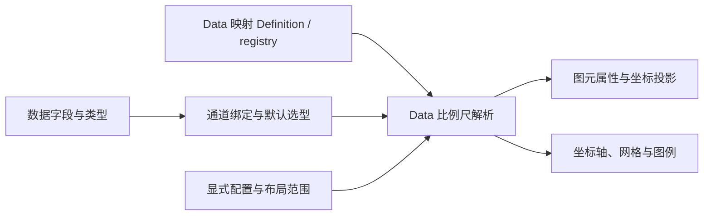

# ADR-029：比例尺的映射定义、选型与绑定消费

- 状态：Accepted
- 决策日期：2026-10-28
- 依赖：[Data 006](../../../data/v0/v0.2/006-scale-mapping.md) 拥有通用映射契约；本 ADR 拥有 Plot 消费语义，不再由 Plot 定义数学比例尺底座
- 关联：[版本规划](./roadmap.md)、[比例尺设计](../../../../architecture/plot-scale-design.md)、[可视化完备设计](../../../../architecture/plot-visualization-complete.md)
- 拟修订：[063](../v0.1/063-scale-registry.md) 的 position/channel 互斥定义与解析契约、[043](../v0.1/043-discretization-scale.md) 的离散化仅输出颜色限制、[030](../v0.1/030-type-driven-scale.md) 的选型职责表达；保留统一注册、既有默认映射和显式优先原则
- 延续：[020](./020-mark-encoding-properties.md) 的字段编码与固定属性边界、[042](../v0.1/042-continuous-color-scale.md) 的连续色带语义、[008](./008-domain-padding-units.md)、[012](./012-mark-aware-domain-padding.md) 与 [016](./016-point-mark-auto-padding.md) 当前有效的留白约束

## 背景与目标

现有 ScaleDefinition 分为 position 与 channel 两族。位置族提供坐标、带宽、刻度与范围更新，channel 族主要提供颜色 evaluator 和图例形态。这使映射规则与消费属性绑定：同一分档算法不能直接用于尺寸，形状的自动分类映射与显式命名比例尺也没有一致入口。

按位置、颜色、尺寸提供配置入口符合作者习惯，应当保留。需要调整的是底层契约：映射类型决定怎样映射，通道决定如何选择与消费，图元及 Guide 使用一致的映射事实。数据类型只是默认选型的输入，不能独自决定比例尺。

## 决策：定义映射、选择配置、绑定消费分别承担稳定职责



Data 拥有通用映射定义、注册和数学解析，继续复用 D3；Plot 与 Table 分别拥有选型、绑定和领域消费。Scale 不直接读取 Mark、坐标系、单元格或 renderer；通道不复制 scale 算法；Guide 不独立训练 domain 或分档边界。不新增发布包，也不要求 Table 依赖 Plot。

1. **定义映射**：Data 按映射规则建立内置与自定义 Definition，提供输入兼容性、标量映射及数学能力。
2. **选择配置**：Plot 根据字段类型、消费目标和图元需求选择默认配置，Table 根据单元格语义选择；显式声明优先，adapter 不各自推断。
3. **绑定消费**：各宿主确定参与映射的数据与共享作用域。Plot 协调数据域与布局范围，图元、Guide 及 locator 消费最终解析结果；Table 保留其 selector、视觉规则与 Legend 解释。

图中表达职责依赖，不取消布局与自动留白的有界协调。隐藏轴或图例不改变数据映射。

## 基础数据结构与公开契约

### 命名比例尺与输出语义

Plot 比例尺声明保留 `type`、`name` 及映射专属配置。`name` 属于 Plot 的命名绑定，数学配置交给 Data。声明不增加 `output` 判别：输出的视觉含义由绑定它的通道确定，不在映射实例重复保存。

`range` 继续位于声明顶层，数学类型约束由映射决定，视觉约束由消费通道决定：数值属性要求有限数，颜色复用 Core 颜色值契约，形状使用 Point 已支持的形状标识。颜色和形状即使都是字符串，也不能仅凭字符串类型判为可互换；本决策不开放任意对象作为映射输出。

Plot 本轮开放的内置输出集合如下，由通用映射能力与 Plot 的输出契约共同约束，不是 Data 的能力上限，也不是消费者维护的内置名称白名单。Table 可使用 Data 的颜色线性插值承接现有实现。

| 映射类型                       | 本轮输出             | 专属语义                          |
| ------------------------------ | -------------------- | --------------------------------- |
| linear、log、pow、sqrt、symlog | number               | 连续数值映射与既有合法域          |
| time                           | number               | 时间输入、UTC 日历刻度            |
| radial                         | number               | 半径与面积关系，不等同于普通 sqrt |
| band、point                    | number               | 分类布局、间距及适用的带宽        |
| ordinal                        | number、color、shape | 类别到离散输出的对应              |
| quantize、quantile、threshold  | number、color        | 等宽、样本分位或显式阈值分档      |
| sequential、diverging          | color                | 连续色带及具有语义中点的发散色带  |

本轮保留全部现有类型及数学含义。sequential/diverging 是连续颜色的正式入口，不同时新增 linear 的颜色插值表面；统一 registry 不要求每种映射支持全部输出。配色方案仍是独立的命名资源，`scheme` 仅适用于颜色输出，显式颜色 `range` 优先于 scheme。

数值或形状输出的 ordinal，以及数值输出的分档比例尺，必须显式给出 range。颜色输出省略 range 时继续使用现有主题或 scheme 默认。quantize/quantile 显式 range 决定档数，显式 count 必须与其长度一致；threshold 的 range 长度必须是断点数量加一。quantile 继续从绑定数据样本训练，不以 extent 替代样本分布。

### 字段绑定与坐标角色

保持现有 Source 入口：`scales` 保存命名声明；非位置 encoding 使用字段字符串，或 `{ field, scale }` 显式引用；位置映射由 coordinate role 引用比例尺，Mark 位置仍绑定字段，不在端点另设 scale 覆盖。

以下为同一分档规则用于颜色和尺寸的声明片段；两者是不同映射实例，分别拥有自己的输出范围。

```ts
{
  scales: [
    {
      name: 'riskColor', type: 'threshold',
      breakpoints: [30, 70], range: ['green', 'orange', 'red'],
    },
    {
      name: 'riskSize', type: 'threshold',
      breakpoints: [30, 70], range: [4, 8, 12],
    },
  ],
  marks: [{
    type: 'point', kind: 'data',
    encodings: {
      position: { x: 'time', y: 'value' },
      color: { field: 'risk', scale: 'riskColor' },
      size: { field: 'risk', scale: 'riskSize' },
    },
  }],
}
```

已开放数值尺度消费的 size、strokeWidth、opacity 目标使用同一数值映射契约，shape 补齐 ordinal 显式引用；颜色类目标继续使用 color 输出。属性的单位、非负要求、透明度区间及支持的形状由对应通道约束，不由 scale 猜测。

这不把所有可编码属性自动改为 scale 通道。文本格式化、series/order、目标引用和固定视觉属性仍按原语义消费。固定数据空间位置仍经过坐标角色 scale；固定颜色、尺寸等视觉属性直接使用目标值。

### 自定义映射与解析结果

自定义参数采用 Core 已有的 `params` / `paramsSchema` 模式：声明通过 `type` 引用定义，实例专属 JSON 参数放在 `params`，运行时定义通过 `paramsSchema` 声明参数契约并向回调提供关联类型。`name`、通用 domain/range 及宿主消费配置不混入映射专属 params；不允许自定义字段任意铺在声明顶层。内置与自定义共同遵循定义、参数解析和映射消费机制。

`params` 是实例数据，不是注册定义、函数或消费策略的容器。数学定义保持 Data 的 `type / paramsSchema / isFieldCompatible / resolve`。位置连续性、基线许可、图例和属性范围都属于消费者，不附加在数学定义上，也不作为实例参数透传。

`defineScale` 与 ScaleDefinition 的公开真源在 Data。Plot 删除 `definePlotScale`、InputPlotScaleDefinition 和 PlotScaleDefinition，不保留转发别名。`options.definitions.scales` 直接接收 Data ScaleDefinition，使自定义数学映射仍能用于已有适用通道；引入新算法本身不要求新增通道。

通道定义负责支持的映射、默认选型、输出约束和 Guide 解释。内置与自定义通道使用同一消费入口；需要新的视觉消费语义时扩展通道，不再创建第二套 Plot 数学定义。位置消费还需明确连续性、基线及布局策略，不能从 `map(0)` 或数值输出猜测。`options.colorSchemes` 作为宿主资源入口传入映射解析。删除旧 `family: position | channel` 判别，不把互斥家族改名后继续作为算法注册条件。

自定义数学映射用于位置通道时，调用方必须在位置通道定义中显式声明该映射的连续性与基线许可；省略消费策略不获得位置许可。刻度展示语义和特殊留白策略也由位置消费者持有。数值映射本身不隐式表示连续位置，也不隐式允许零基线。数学映射可以独立注册并用于适用的普通属性，不因此承担位置协议。

统一 Data ScaleDefinition 包含 type、paramsSchema、输入兼容判断和 resolve。Plot 校验视觉输出与绑定，向 Data 传入映射 operation、选定样本和明确资源；Data 不读取 Plot 名称、通道、主题对象或图元树。颜色与形状合法性继续使用 Plot 所依赖的 Core 契约，不能为此使 Data 反向依赖 Core。

Data ScaleResolution 提供 map、最终 domain/range 与数学能力。Plot 的消费解析附加视觉 output 约束与必要领域能力，不建立第二套映射。map 的无有效映射结果使用 undefined，既有消费者的缺值策略负责决定跳过、分段或使用领域默认；声明错误与能力不匹配不转成缺值。

Data 只返回数学映射及算法直接支持的成员，不声明消费能力清单。Plot 的通道消费者持有位置连续性、基线许可、刻度展示语义、图例形式及布局策略。分类列表直接使用 domain，分档边界使用 thresholds，连续图例由 Plot 对实际 map 采样；输出布局界限由消费方计算，不反向写入 Data 契约。

| Plot 消费项     | 公开语义与消费要求                                                      |
| --------------- | ----------------------------------------------------------------------- |
| `position`      | 数值结果可作为坐标角色；明确连续性、基线许可及按新 range 重建映射的操作 |
| `ticks`         | 读取 Data 原始代表值，Plot 选择 number/time/category 语义并格式化标签   |
| `categories`    | 确定顺序的实际类别；分类轴与图例复用该顺序                              |
| `band`          | 当前映射的带宽和 step；band 的 map 返回中心，边界由带宽获得             |
| `bins`          | 实际分档内部边界及每档输出，包含 threshold 两端无界区间的语义           |
| `continuous`    | 连续 domain 上的采样能力，使用实际 map，支持连续图例解释                |
| `domainPadding` | 复用现有合法域、非钳位归一化和留白重建契约                              |
| `outputBounds`  | 给出当前消费数据域上可靠的数值输出界限，供尺寸估计与自动留白使用        |

Point scale 的分类间距由 position 能力提供，带宽为零不代表它具有 band 区间能力。普通连续映射不伪造带宽。位置映射并不因返回 number 就自动成立；ordinal 或分档数值输出也不因此成为可用的坐标角色。

位置消费者只要求 position；请求 Axis/Grid 时另要求 ticks，使用 band 区间时要求 band，启用自动留白时要求对应留白能力。自定义映射可以仅用于属性绘制；当用户请求缺失的 Guide 或布局能力时明确失败，不强迫它实现无关能力。

Data 的 invert 是数值算法的反向计算，用于 Plot 组合域重建与自动留白，不新增 Plot 交互反向查询 API。非单射分类或分档映射不声明唯一逆值。

### 选型与默认配置

字段类型由 Data 提供；Plot 负责根据通道和现有图元需求确定默认映射。优先级为显式引用、既有通道/图元默认、字段类型默认；同一作用域内显式引用不存在时直接失败，不退回自动推断。

| 消费                | 默认处理                                                                 |
| ------------------- | ------------------------------------------------------------------------ |
| 连续数值位置        | linear                                                                   |
| 时间位置            | time，保留 UTC                                                           |
| 分类位置            | 保留现有 band 默认，point 由显式声明选择；不借重构切换 Point/Path 的默认 |
| 分类颜色            | ordinal，主题分类配色                                                    |
| 数值/时间颜色       | sequential，现有主题默认色带                                             |
| shape               | 保留现有分类映射与形状顺序，统一为 ordinal 解析                          |
| size 与其他数值属性 | 保留各目标现有默认映射、范围或直通规则；显式引用时消费统一 number 输出   |

“保留”不表示允许 adapter 继续维护独有推断。各入口相同有效输入必须汇合到 Plot 的同一选型规则；不能把原来直通的数值属性静默改成按数据 extent 归一化。

### 数据域、共享与布局

域收集使用当前有效绑定、最终局部变换结果和既有分面作用域，遵守 contributeToDomain。被固定属性或上层规则覆盖而失效的绑定不创建额外尺度。显式 domain 不被其它消费者的数据静默扩展。

同一作用域内引用同一命名声明表达共享映射配置；需要推断的 domain 收集该共享组的有效贡献。quantile 对同一数据视图的同一字段不因多个图元重复引用而重复计样本，真实数据中的重复值仍保留。不同数据视图的样本合并，不能按值去重。

仅使用相同 type 或相同字段名不建立新的共享关系。自动派生、分面独立/共享与 coordinateView 的既有分组规则保持；不新增 G2 式默认同步或新的共享开关。

共享数据域不等于共享可变 range。布局相关的位置映射在各消费视图中独立构建最终 range，更新一个视图不得污染另一个视图；显式 range 仍受原有展开策略约束。同一声明不能同时满足互相冲突的输出语义或字段兼容要求，冲突必须报错，不按遍历先后选择。

自动留白继续由 Plot 协调：尺寸先于本轮位置留白确定，分类域不增加虚拟类别，共享域满足各消费视图约束，协调过程有界并验证最终结果。图元、Guide 和 locator 必须使用同一个最终映射版本。

### Guide 与宿主入口

Scale 提供类别、刻度、采样和分档事实，不再返回强制的 `legendForm: ramp | swatch`。Guide 结合消费通道决定颜色色带、色块、尺寸符号或形状符号；布局与图形呈现继续复用 Standard。

number 分档用于 size 时提供分档尺寸图例，ordinal 用于 shape 时提供形状图例。分位边界、类别顺序与样本输出只从同一解析结果取得；隐藏 Guide 不影响 domain 或映射。quantile 没有有效样本时不生成分档图例及其标题，不虚构零边界。

JSON、Vanilla 与 React 支持同一组完整声明与引用，包含 pow、diverging 和自定义类型。React 的 PlotScale 接收与 Vanilla 相同的声明能力，不维护内置类型子集；已有按属性引用的便利入口保留。Chart 继续将高级内联意图展开为 Plot 命名声明和绑定，不拥有另一套比例尺算法。

## 行为、失败语义与兼容性

本决策不新增比例尺类型，不改变 time 的 UTC 策略、log 正域限制、pow/sqrt 的合法输入、现有基线许可、nice/clamp 默认、单值/空域与缺值处理规则。配置非法与数据缺失必须区分：前者诊断，后者按既有消费者策略处理。新组合中合法输入映射出的非法属性值必须报错，例如 opacity 超出允许区间，不能以 clamp 偷换属性校验。

Data 对未知或重复映射 type、非法数学配置和通用解析错误产生 RetikzDataError；Plot 对重复声明名称、引用、视觉输出与消费能力不兼容及共享/布局约束产生 RetikzPlotError。Plot 补充绑定上下文时保留 Data 错误为 cause，第三方回调异常在所属能力边界包装。外部 JSON 在解析边界校验，内部类型化结果不重复进行 schema 结构解析。

这是破坏性契约调整：旧分族 Definition、Plot 数学定义包装和结果类型直接删除，不保留旧名别名、双读字段、兼容 wrapper 或 fallback。旧的数学行为不因公开结构改变而改变；自定义实现必须迁移到 Data 数学定义与通道消费契约。

## 文档入口

Data 文档讲解数学比例尺的类型、参数及自定义定义。Plot 总览说明如何将映射绑定到消费通道，下分位置比例尺与图元属性映射。位置单列，因为它参与坐标投影、坐标轴和布局；颜色、尺寸、透明度、描边宽度与形状在图元属性映射中按通道说明默认值和支持范围。

删除 Plot 独立的自定义比例尺页面。自定义通道文档说明如何消费 Data 映射、校验输出及提供图例；数学算法的定义与注册指向 Data 文档，不重复建立另一套 API。文档只有在相应组合完成实现与验证后才能将其描述为当前可用。

Data 底座与 Plot/Table 消费必须形成闭环。Plot、Chart 生成声明、Vanilla、React 与中英文使用文档同步切换；Table 迁移保留连续配色 clamp=true、分类颜色数量要求及其空数据/缺值策略，不套用 Plot 默认。本文按列出的具体边界修订相关决策，不将仍有效的数学和布局规则整体废弃。Accepted 表示设计获批，不表示实现或发布完成。
